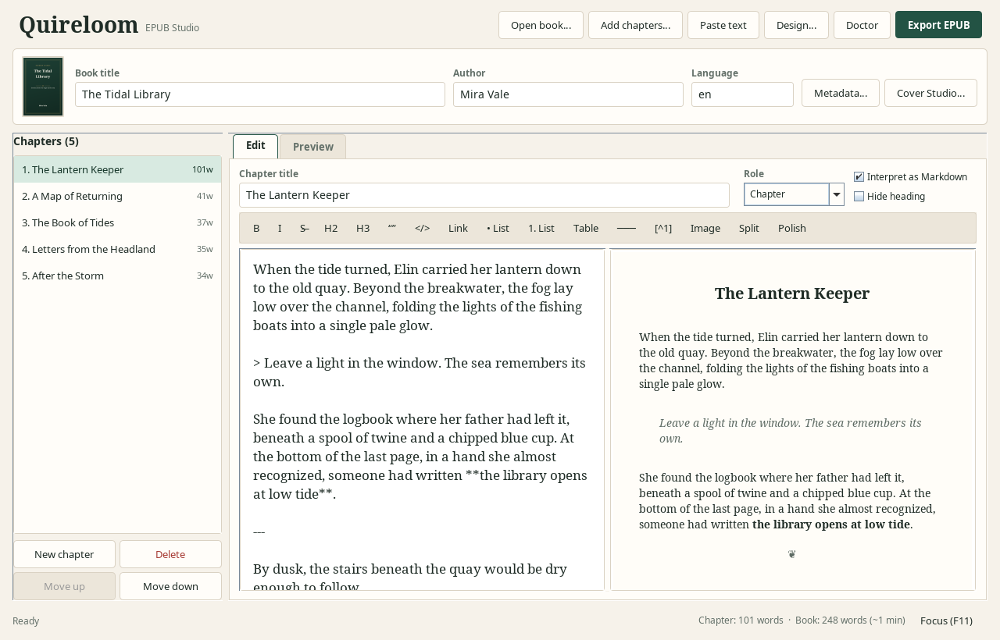
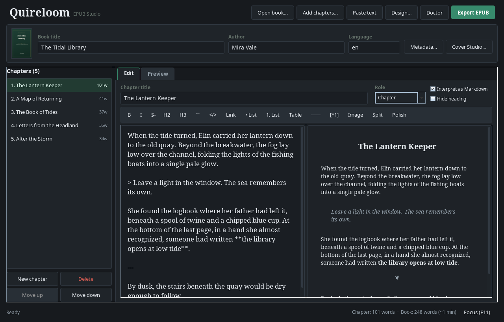
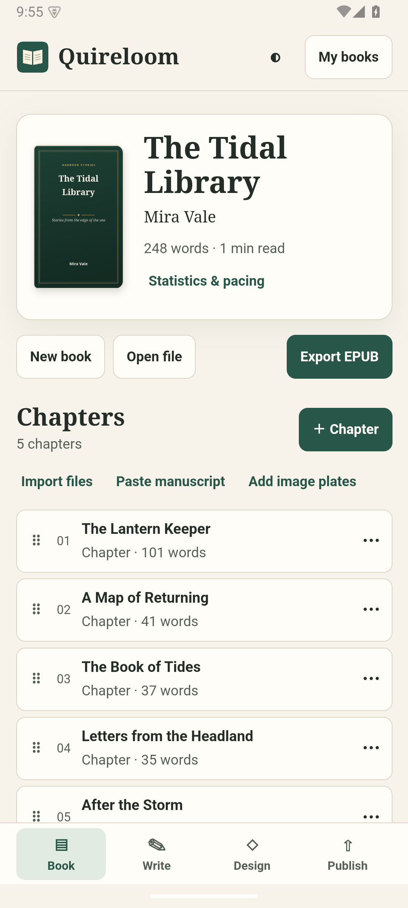
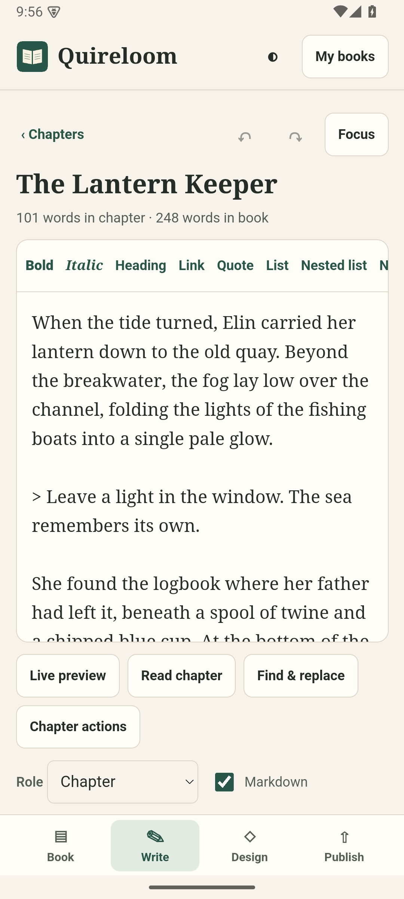
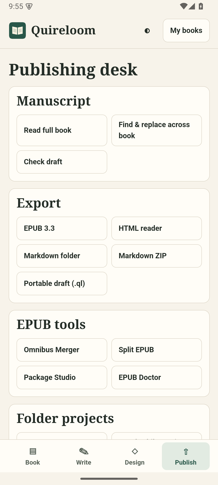

# Quireloom

Quireloom is an offline EPUB authoring and publishing studio for **Linux** and
**Android**. Write in Markdown or plain text, design the finished book, and
export EPUB 3.3, a self-contained HTML reader, or a Markdown folder with its
assets. Use the publishing tools to merge volumes, split an omnibus, inspect an
EPUB package, or check and repair a book. Quireloom runs without Calibre or an
online account.

[Screenshots](#screenshots) · [Linux desktop](#linux-desktop) · [Android](#android) ·
[Publishing tools](#publishing-tools) · [Linux CLI](#linux-cli) ·
[Build and verify](#build-and-verify)

## Screenshots

### Linux workspace

The desktop editor keeps the chapter list, Markdown manuscript, and live
preview visible together. Both images show the sample manuscript *The Tidal
Library*.



<details>
<summary>View Midnight Ink dark mode</summary>



</details>

### Android workspace

<table>
  <tr>
    <th>Book</th>
    <th>Write</th>
    <th>Publish</th>
  </tr>
  <tr>
    <td></td>
    <td></td>
    <td></td>
  </tr>
</table>

## Linux desktop

### Install and launch

Build the Debian package on a Linux system with JDK 17 or newer and
`dpkg-deb`. On Debian or Ubuntu, install the resulting package with APT.

```sh
./linux/build.sh
sudo apt install ./linux/build/quireloom_1.0.0_all.deb
quireloom
```

The build also produces a standalone JAR. On a Linux desktop with a graphical
Java runtime, launch it with `java -jar linux/build/quireloom.jar`.

### Write and edit

1. Choose **File → New Book** to create a portable `.ql` draft. Use **Open
   Book** to resume a draft or convert an EPUB into editable chapters.
2. Use **Add chapters** to import files, **Paste text** to bring in a
   manuscript, or **New chapter** to start writing. Enable heading detection
   when pasting a manuscript that should become several chapters.
3. Drag chapters into reading order. The **Chapter** menu also lets you
   duplicate, split at the cursor, split by headings, or merge with the
   next chapter. Use **Edit → Undo Chapter Structure Change** to reverse a
   structural edit.
4. Open **Design** to set catalog metadata, typography, and the cover. Use the
   **Doctor** button for preflight checks before exporting from **File**.

The editor shows chapter and book word counts and an estimated reading time.
Open **Publishing → Manuscript Statistics & Pacing** for a chapter-by-chapter
view. Use the **View** menu to switch between the Warm Parchment and Midnight
Ink themes or open the full book preview in a browser.

| Shortcut | Action |
| --- | --- |
| `Ctrl+N` / `Ctrl+O` | Create or open a book |
| `Ctrl+S` | Save the draft now |
| `Ctrl+Z` / `Ctrl+Shift+Z` | Undo or redo text edits |
| `Ctrl+B` / `Ctrl+I` / `Ctrl+K` | Bold, italic, or insert a link |
| `Ctrl+F` / `Ctrl+H` | Find or replace within a chapter |
| `Ctrl+Shift+H` | Find and replace across the book |
| `Ctrl+Shift+P` | Toggle side-by-side preview |
| `F11` | Toggle focus mode |
| `Ctrl+E` | Export EPUB |

Launch `quireloom ./my-book.ql` or `quireloom ./my-book.epub` to open a book
directly. The app keeps its library and lock files under
`${XDG_DATA_HOME:-~/.local/share}/quireloom`.

## Android

### Install

Quireloom supports **Android 13 or later**. Open the APK on your device or
install a local build over USB with `adb`. See
[Build and verify](#build-and-verify) for the build command and APK path.

### Use the workspace

| Tab | What you can do |
| --- | --- |
| **Book** | Open an EPUB or draft, switch between saved books, import files, and paste a manuscript with heading detection. Drag a chapter handle to reorder, or set the position in the chapter menu. |
| **Write** | Edit chapters, insert Markdown and illustrations, use text and structure undo/redo, and switch to focus mode. Enable **Live preview** to see the rendered chapter. The editor and preview sit side by side on wider screens. |
| **Design** | Edit catalog metadata, choose a typography theme, configure title and copyright pages, add custom CSS, and design or import a cover. |
| **Publish** | Preview the full book, run EPUB Doctor, export the manuscript, merge or split EPUBs, inspect a package, or build and watch a source folder. |

Drafts autosave on the device. To move a project between Linux and Android,
export **Publish → Portable draft (.ql)** on Android or copy the `.ql` draft
from Linux, then open the file in Quireloom on the other device.

Android uses the system Files picker for import and export. Folder watch runs
while Quireloom is in the foreground. PDF text extraction is available on
Android 15 and later. On Android 13 and 14, PDF pages import as illustrations.
An in-place APK upgrade requires the same signing key as the installed app.
Export your drafts before switching keys.

## Publishing tools

### Import and format a manuscript

Import Markdown, UTF-8 plain text, EPUB 2 or 3, PDFs, or images. EPUB manuscript
import converts supported formatting such as headings, emphasis, lists, tables,
and blockquotes to editable Markdown and brings in cover art, inline
illustrations, and available metadata. If the source EPUB changes after
import, Quireloom can resume your draft, reload the source, or open the source
in Package Studio.

The Markdown editor supports links, nested lists, task lists, tables, code
blocks, scene breaks, and EPUB footnotes. Use an inline illustration inside a
chapter or import an image as a plate chapter. Find and replace supports case
matching and regular expressions. Book-wide replacement can search chapter
titles and protects embedded illustration markers.

### Design the book and cover

- **Typography** offers Classic Book, Modern Editorial, Literary Paper,
  Technical & Docs, Poetry & Verse, and Minimal E-Ink. Configure smart
  punctuation, drop caps, and scene-break ornaments, or add custom CSS.
- **Front matter and navigation** include optional title and copyright pages,
  part dividers that group chapters in the table of contents, and an optional
  NCX navigation file for older EPUB readers.
- **Cover Designer** creates 1600 × 2560 covers from six templates and eight
  palettes. Add a subtitle, series badge, and a background photo with Photo
  Overlay, then attach the cover to the book or save a standalone PNG.

### Work with existing EPUBs

| Tool | What it does |
| --- | --- |
| **Omnibus Merger** | Combine EPUBs, manuscripts, images, and PDFs. Set volume order, choose EPUB chapters, add volume dividers and a cover, and keep each EPUB volume’s styles and assets isolated. |
| **EPUB Splitter** | Split a book by top-level table-of-contents entries or by a fixed number of chapters. Each volume keeps the resources its chapters reference. Android can save a folder of EPUBs or a ZIP. |
| **Package Studio** | Open and edit XHTML, CSS, OPF metadata, reading order, covers, and assets in the original package structure. Preview resources, run cross-file find and replace, and optimize images. Android writes an edited EPUB copy through Files. |
| **EPUB Doctor** | Check draft metadata and assets, or audit an EPUB for archive layout, manifest and spine consistency, malformed XML, broken links, missing image descriptions, and oversized assets. Repair can upgrade an EPUB 2 package, normalize XHTML, remove orphan files, and optionally optimize images. |

### Choose an export format

| Format | Use it for |
| --- | --- |
| **EPUB 3.3** | A finished book for EPUB readers, with navigation, styling, and embedded book assets. |
| **HTML reader** | A standalone web document with book navigation, light, sepia, and dark reading themes, and font-size controls. |
| **Markdown folder** | Editable chapter files and an `assets/` folder. Android also offers a ZIP export. |
| **Portable draft (`.ql`)** | Moving or backing up the editable project, including metadata, chapter roles, design settings, cover, and illustrations. |

## Linux CLI

The CLI runs headlessly. Use the installed `quireloom` command or
`./linux/build/quireloom` from the project directory.

```sh
# Build a manuscript folder and resolve its local Markdown images
quireloom build ./my-book --title "The Tidal Library" --author "Mira Vale" \
  --theme LITERARY --smart-quotes -o ./book.epub

# Rebuild when a source file changes
quireloom build ./my-book --watch -o ./preview.epub

# Create an omnibus with a custom cover
quireloom merge volume1.epub volume2.epub --title "Collected Stories" \
  --cover cover.png -o omnibus.epub

# Split by top-level contents, or group five chapters per output volume
quireloom split omnibus.epub -o ./volumes --by parts
quireloom split book.epub -o ./chunks --by size --size 5

# Inspect, preflight, and repair a book
quireloom info omnibus.epub
quireloom check omnibus.epub
quireloom fix old-book.epub -o fixed-book.epub --optimize-images --max-dim 1600
```

`quireloom check` returns a nonzero exit code when it finds errors, so it can
be used in CI. Run `quireloom --help` for supported options, including
`--lang`, `--pdf-images`, and `--no-dividers`.

## Build and verify

### Linux

Use JDK 17 or newer and `dpkg-deb`. Install `poppler-utils` for PDF import.
The regression script builds the package, exercises the EPUB engine and
desktop workspace, and checks the packaged CLI.

```sh
./linux/build.sh
./linux/test.sh
```

To also check generated EPUBs with an installed copy of EPUBCheck, point the
test script at its runnable JAR.

```sh
EPUBCHECK_JAR=/path/to/epubcheck.jar ./linux/test.sh
```

### Android build

Use JDK 17 or newer, Android SDK Platform 36, and Android SDK Platform-Tools
if you plan to install via `adb`. The Gradle wrapper builds the APK and runs
Android lint.

```sh
./gradlew :app:assembleDebug :app:lintDebug
adb install -r app/build/outputs/apk/debug/app-debug.apk
```

The debug APK is generated at `app/build/outputs/apk/debug/app-debug.apk`.
Use an Android 13+ device or emulator to test import, editing, and export.

### Source layout

| Path | Contents |
| --- | --- |
| [`linux/src/`](linux/src/) | Linux Swing studio, publishing tools, and CLI |
| [`linux/test/`](linux/test/) | Linux regression suite |
| [`app/src/main/java/`](app/src/main/java/) | Android activity, file access, publishing tools, and the shared EPUB writer and Markdown renderer |
| [`app/src/main/assets/`](app/src/main/assets/) | Android workspace layout, styling, and editor interactions |
| [`docs/screenshots/`](docs/screenshots/) | Linux and Android screenshots used in this README |
